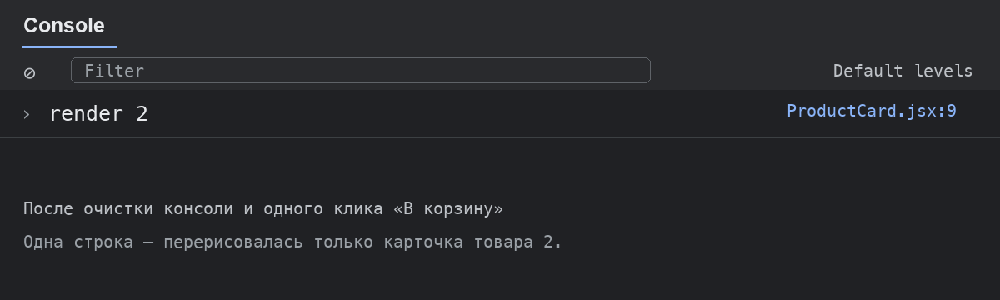

# Каталог товаров

Учебное приложение на React: каталог из 5 000 товаров с поиском, фильтром по наличию и корзиной.

## Запуск

```bash
npm install
npm run dev
```

Проверка проекта:

```bash
npm run lint
npm run build
```

## Что реализовано

- поиск без учёта регистра и пробелов по краям строки;
- фильтр «Только в наличии» и счётчик найденных товаров;
- автофокус в поле поиска после загрузки страницы;
- корзина на `useReducer`: добавление, удаление и очистка;
- подсчёт общего количества и стоимости товаров;
- `memo`, `useCallback` и `useMemo` для сокращения перерисовок;
- отзывчивый поиск через `useTransition`;
- логика корзины вынесена в пользовательский хук `useCart`.

## Проверка перерисовок

После очистки консоли один клик по кнопке «В корзину» добавляет одну строку `render`: перерисовывается только изменившаяся карточка.



`useCallback` нужен для сохранения ссылок на обработчики. Без него при каждом рендере `App` создавались бы новые функции, поверхностное сравнение props в `memo` считало бы их изменившимися, и все карточки рендерились бы снова.

## Коммиты

- `step-1` — поиск и фильтр;
- `step-2` — корзина на `useReducer`;
- `step-3` — оптимизация перерисовок;
- `step-4` — `useTransition` и `useCart`.
